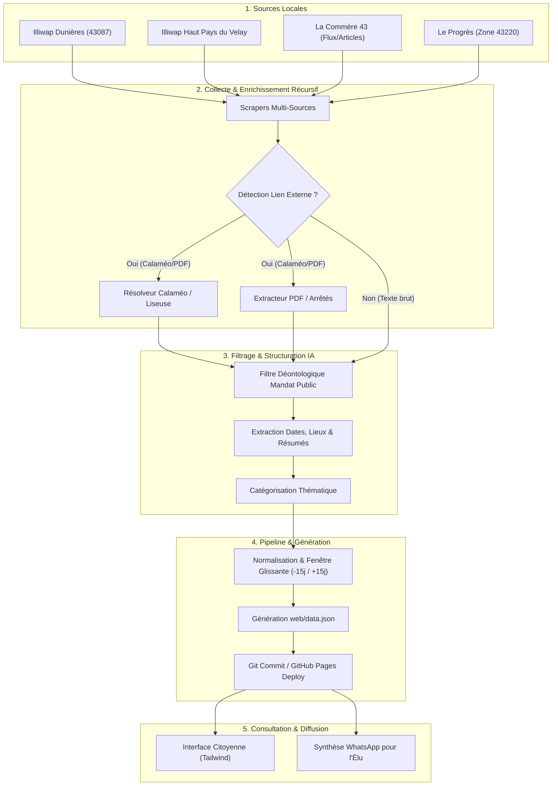
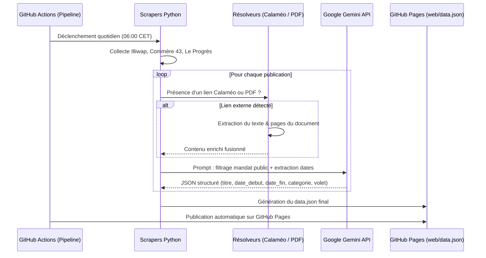

# 🏛️ Architecture Technique & Schéma des Flux

Ce document détaille l'architecture logicielle, la chaîne de traitement de données et les mécanismes de sécurité de la solution **Portail Citoyen & Calendrier Automatisé** pour la commune de Dunières et le Haut Pays du Velay Communauté.

---

## 1. Vue d'Ensemble de l'Architecture

La solution repose sur une architecture **Jamstack 100 % Cloud**, serverless et à coût nul :
- **Orchestrateur & Exécution** : GitHub Actions (tâches planifiées Cron quotidiennes).
- **Moteur de traitement** : Scripts Python 3.11 modulaires (collecte, enrichissement récursif, IA).
- **Modèle d'Intelligence Artificielle** : Google Gemini API (tri déontologique, extraction d'entités temporelles).
- **Base de données / Stockage** : Fichier plat `web/data.json` mis à jour de façon déterministe.
- **Hébergement Frontend** : GitHub Pages (haute disponibilité, CDN mondial, zéro maintenance serveur).
- **Canal d'alerte Élu (Optionnel)** : Passerelle WhatsApp CallMeBot.



---

## 2. Collecte Multi-Sources & Résolution Récursive (2 Étapes)

L'un des défis majeurs dans la communication municipale est que les annonces publiées sur les réseaux ou Illiwap contiennent fréquemment un lien externe renvoyant vers un document externe (brochure Calaméo des festivités estivales, arrêté municipal au format PDF, affiche d'association hébergée sur un drive).

### Étape 1 : Collecte Initiale
- **Illiwap** : Récupération des messages récents via l'API publique d'Illiwap ou scrapping de la station de Dunières (`43087`) et de la communauté de communes.
- **Presse Locale (La Commère 43 & Le Progrès)** : Surveillance des flux RSS et articles géolocalisés sur Dunières et les communes limitrophes du Haut Pays du Velay.

### Étape 2 : Résolution Récursive Approfondie
Chaque message brut est analysé par regex pour identifier des liens externes vers :
1. **Calaméo** :
   - Détection des URLs `calameo.com/read/...` ou `calameo.com/books/...`.
   - Extraction de l'identifiant du document (`book_id`) et interrogation de l'API de lecture publique ou extraction du flux SVG/texte des pages pour en extraire le contenu sans exécuter de navigateur lourd.
2. **Fichiers PDF / Arrêtés municipaux** :
   - Téléchargement éphémère du PDF.
   - Extraction du texte via `pypdf` ou `pdfplumber`.
3. **Affiches / Images contenant du texte** :
   - Si une annonce comporte une image avec peu ou pas de texte d'accompagnement, l'image est soumise au modèle multimodal Gemini pour extraction OCR contextuelle.



---

## 3. Filtrage Déontologique & Tri par Intelligence Artificielle

### Exigences Déontologiques et Légales
En tant qu'élu local, la publication doit respecter scrupuleusement la neutralité républicaine, le cadre du mandat et le RGPD :
- **Autorisé & Valorisé** :
  - Vie municipale, arrêtés de voirie, travaux publics, délibérations.
  - Événements associatifs, sportifs et culturels ouverts à tous.
  - Démarches citoyennes, déchèteries, horaires de services publics.
  - Alertes locales (intempéries, coupures d'eau, alertes sanitaires).
- **Exclu formellement** :
  - Faits divers individuels sans portée réglementaire ou collective.
  - Contenus à visée commerciale privée (hors annonces d'intérêt général).
  - Données à caractère personnel sensibles.
  - Polémiques partisanes ou débats d'opinion privés.

### Schéma de Données de Sortie (`data.json`)
Chaque événement retenu est formaté selon le modèle JSON suivant :

```json
{
  "id": "illiwap-43087-20261101-01",
  "title": "Travaux de réfection rue du 19-Mars-1962",
  "summary": "Circulation alternée par feux tricolores du 3 au 7 novembre inclus.",
  "category": "Travaux & Voirie",
  "badge": "Arrêté Municipal",
  "source_name": "Illiwap Mairie de Dunières",
  "source_url": "https://station.illiwap.com/fr/ville/dunieres",
  "dates": {
    "start": "2026-11-03T08:00:00+01:00",
    "end": "2026-11-07T18:00:00+01:00",
    "is_period": true,
    "bucket": "upcoming" 
  },
  "location": "Rue du 19-Mars-1962, Dunières",
  "importance": "high",
  "has_attachment": true,
  "attachment_url": "https://www.calameo.com/read/...",
  "updated_at": "2026-11-01T06:00:00Z"
}
```

Les 3 volets du calendrier correspondent à la valeur de `dates.bucket` :
- `retrospective` : Dates situées entre $J-15$ et $J-1$.
- `today` : Dates actives au jour $J$.
- `upcoming` : Dates situées entre $J+1$ et $J+15$.

---

## 4. Pipeline d'Automatisation GitHub Actions

Le workflow s'exécute selon une planification Cron (tous les matins à 6h00 Paris time, soit 5h00 UTC en hiver / 4h00 UTC en été) ainsi que sur déclenchement manuel (`workflow_dispatch`).

### Étapes du Pipeline :
1. **Checkout & Configuration** :
   - Récupération du code source.
   - Initialisation de Python 3.11 avec mise en cache des paquets pip (`cache: 'pip'`).
2. **Collecte & Résolution Récursive** :
   - Exécution de `src/main.py`.
   - Interrogation des APIs et flux d'actualités.
   - Extraction des documents Calaméo et PDF distants.
3. **Analyse IA & Normalisation** :
   - Appel à l'API Gemini avec gestion d'erreurs (fallback dégradé si quota dépassé).
   - Génération atomique du fichier `web/data.json`.
4. **Déploiement GitHub Pages** :
   - Validation de l'intégrité du fichier JSON.
   - Déploiement direct de l'artefact web via les actions officielles GitHub Pages (`actions/deploy-pages`).
5. **Notification Élu (Optionnelle)** :
   - Envoi d'un message synthétique sur WhatsApp via CallMeBot précisant le nombre d'événements publiés et les alertes du jour.

---

## 5. Gestion des Secrets & Sécurité

Aucun secret, token ou clé API n'est présent dans le code source :
- `GEMINI_API_KEY` : stocké dans les **GitHub Actions Secrets**.
- `CALLMEBOT_API_KEY` et `CALLMEBOT_PHONE` : stockés dans les **GitHub Actions Secrets**.
- Le pipeline GitHub Actions fonctionne avec les permissions minimales requises (`permissions: contents: read, pages: write, id-token: write`).
- Les appels HTTP vers l'extérieur sont limités en lecture (GET) avec un timeout strict (15 secondes) pour éviter tout blocage du workflow.
