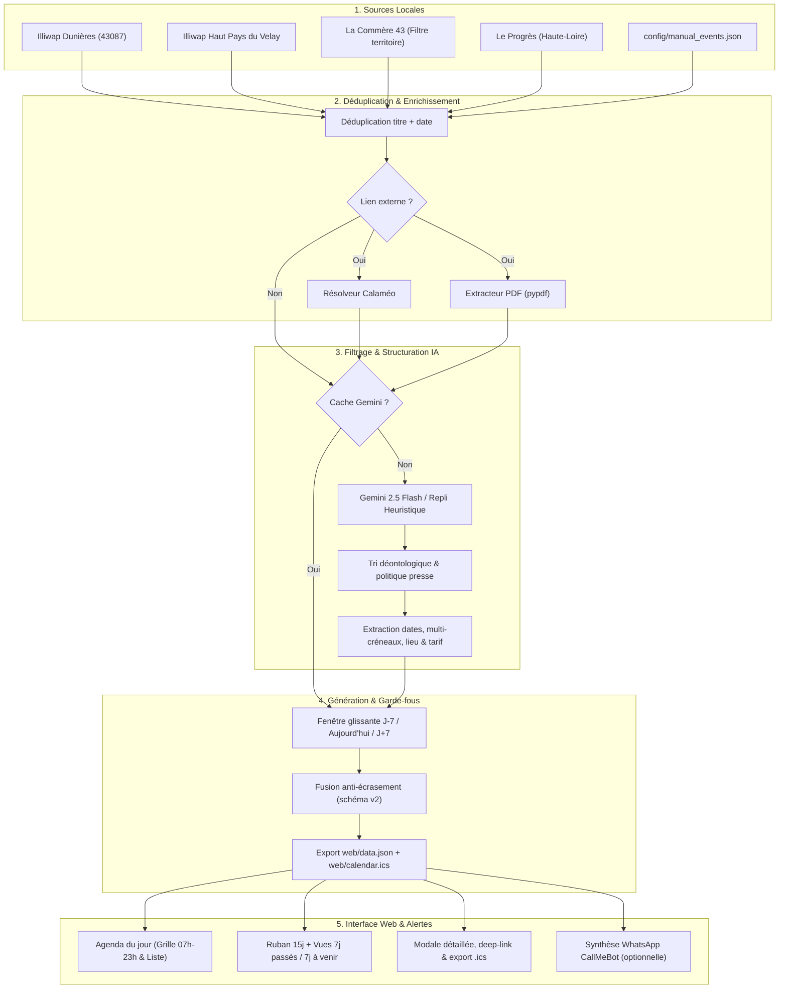

# 🏛️ Architecture Technique & Schéma des Flux

Ce document détaille l'architecture logicielle, la chaîne de traitement de données et les mécanismes de fiabilité de la solution **Calendrier Citoyen de Dunières** pour la commune de Dunières et le Haut Pays du Velay Communauté.

---

## 1. Vue d'Ensemble de l'Architecture

La solution repose sur une architecture **Jamstack 100 % Cloud**, serverless et à coût nul :
- **Orchestrateur & CI/CD** : GitHub Actions (`daily-pipeline.yml` exécuté chaque matin à `04:17 UTC` + `ci.yml` pour les tests à chaque `push`/`PR` et le déploiement sur modification de `web/`).
- **Moteur de traitement** : Scripts Python 3.11 modulaires avec client HTTP `requests` doté de retries/backoff et masquage des paramètres sensibles dans les logs.
- **Modèle d'Intelligence Artificielle** : Google Gemini (`gemini-2.5-flash`) avec schéma Pydantic strict (`Literal` pour catégories, importance et nature éditoriale), cache disque persisté entre runs (`data/cache/classifier_cache.json`), support multimodal des affiches courtes et repli heuristique déterministe.
- **Stockage & Flux ouverts** :
  - `web/data.json` (schéma v2 sans duplication : objets complets dans `all_events`, références par ID dans `buckets`, garde-fou anti-écrasement en cas de panne source).
  - `web/calendar.ics` (flux iCalendar RFC 5545 prêt à l'abonnement).
- **Hébergement Frontend** : GitHub Pages (HTML/JS statique, manifeste PWA léger, zéro backend).

---

## 2. Conception de l'Interface : Vue Google Calendar Épurée

1. **Ruban interactif 15 jours (`J-7` → `Aujourd'hui` → `J+7`)** :
   - Grille 15 colonnes sur desktop et ruban horizontal scrollable sur mobile.
   - Pastilles colorées par catégorie indiquant d'un coup d'œil la densité des événements.
2. **Vue « Agenda du jour » (par défaut)** :
   - **Zone « Toute la journée »** pour les informations continues, arrêtés ou publications sans horaire fixe.
   - **Grille horaire `07h–23h`** avec calcul des colonnes en cas de chevauchements, affichage des événements multi-créneaux et ligne « Maintenant » sur `Europe/Paris`.
   - **Bascule Grille / Liste** instantanée et navigation clavier (`←` / `→` / `Échap`).
3. **Vues « 7j passés » & « 7j à venir »** :
   - Ruban compact 7 jours + cartes chronologiques cliquables et accessibles au clavier.
4. **Modale fiche événement** :
   - Affiche grand format, date, créneaux horaires, lieu, tarif explicite, pièce jointe Calaméo/PDF avec aperçu texte.
   - Liens d'action : source officielle, **+ Ajouter à Google Calendar**, téléchargement **`.ics`**, et **Partager** par lien direct (`?day=YYYY-MM-DD&event=...`).
