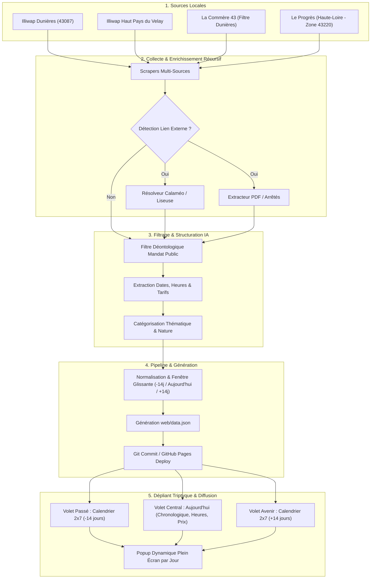

# 🏛️ Architecture Technique & Schéma des Flux

Ce document détaille l'architecture logicielle, la chaîne de traitement de données et les mécanismes de sécurité de la solution **Le calendrier Dunièrois de Maxime JACQUIOT** pour la commune de Dunières et le Haut Pays du Velay Communauté.

---

## 1. Vue d'Ensemble de l'Architecture

La solution repose sur une architecture **Jamstack 100 % Cloud**, serverless et à coût nul :
- **Orchestrateur & Exécution** : GitHub Actions (tâches planifiées Cron quotidiennes à 06h00 et déclenchement manuel).
- **Moteur de traitement** : Scripts Python 3.11 modulaires (collecte, enrichissement récursif, IA).
- **Modèle d'Intelligence Artificielle** : Google Gemini API (tri déontologique, extraction temporelle et catégorisation).
- **Stockage de Données** : Fichier plat `web/data.json` mis à jour de façon déterministe.
- **Hébergement Frontend** : GitHub Pages (haute disponibilité, CDN mondial, zéro maintenance serveur).
- **Interface Utilisateur** : Dépliant triptyque 3D minimaliste avec calendriers 2x7 (-14j / +14j), vue Aujourd'hui chronologique et popups dynamiques par jour.

---

## 2. Conception de l'Interface : Dépliant Triptyque

L'interface est conçue selon la métaphore tactile d'un **dépliant papier triptyque à trois volets** :

1. **Volet Central (« Aujourd'hui »)** :
   - Foyer principal d'ouverture de l'application.
   - Événements actifs ordonnés **chronologiquement**.
   - Visibilité immédiate des 3 piliers d'identification : **l'horaire précis**, **la nature de l'événement** et **le tarif / prix**.

2. **Volets Latéraux Pliés (Effet 3D)** :
   - Sur grand écran, des rabats inclinés en 3D avec ombrage de pli révèlent les deux autres pages sur les côtés de l'écran.
   - Clic direct sur le volet de gauche ou la flèche gauche `◀` pour déplier le passé.
   - Clic direct sur le volet de droite ou la flèche droite `▶` pour déplier l'avenir.

3. **Calendriers 2 Lignes × 7 Colonnes (14 Jours)** :
   - Dans le volet passé (-14 jours) et avenir (+14 jours), la grille organise exactement 14 jours.
   - Chaque case affiche en direct **l'horaire et le titre complet** sans troncature brutale.
   - Les jours calmes restent épurés pour faire ressortir instantanément les journées actives.

4. **Popup Dynamique Plein Écran** :
   - Clic sur n'importe quel jour pour ouvrir une vue détaillée de toute la journée.
   - Navigation jour par jour intégrée (`◀ Jour` / `Jour ▶`) sans quitter la fenêtre modale.
